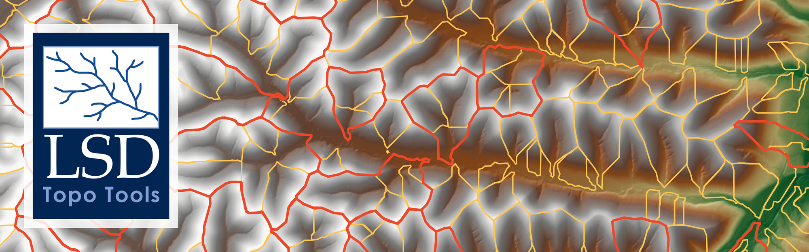

# lsdviztools3



[](https://github.com/LSDtopotools/lsdviztools3/releases/latest)
[](https://github.com/LSDtopotools/lsdviztools3/actions/workflows/release.yml)
[](https://lsdtopotools.github.io/lsdviztools3/)
[](https://github.com/LSDtopotools/lsdviztools3/actions/workflows/docs.yml)
[](https://github.com/LSDtopotools/lsdviztools3/blob/main/LICENSE)
[](https://doi.org/10.5281/zenodo.24113499)

Welcome to `lsdviztools3`, the visualisation package for [`lsdtt3`](https://github.com/LSDtopotools/lsdtt3) ([documentation](https://lsdtopotools.github.io/lsdtt3/)). `lsdtt3` is a software package for topographic analysis, landscape evolution modelling, and hydrology, which runs in a command line environment, or in python with our python bindings. Outputs from `lsdtt3` can be visualised in any GIS software package, but `lsdviztools3` has been built to:

* Enable production of publication-ready figures from `lsdtt3` outputs. It can also work with other standard geographic outputs generated from alternative topographic analysis packages. 
* Provide python based wrappers around `lsdtt3` command line programs so analysis can be run in python notebooks (although this is better suited to the `lsdtt3` python bindings). 

`lsdviztools3` is a ground-up rewrite of the `lsdviztools` plotting stack around
[PyGMT](https://www.pygmt.org/) (maps) and matplotlib (x–y charts). It covers
hillshades, channel networks coloured by log₁₀ k_sn, points size-scaled by
drainage area, basins, locator basemaps, general multi-layer vector overlays on
a hillshade (lines/points/polygons), chi profiles (individual + stacked), swath
profiles, rose diagrams and circular comparison of bearings, and many other
options.

**Full usage guide with examples for every plot (CLI and notebook):
<https://lsdtopotools.github.io/lsdviztools3/>** (the source is
[`docs/`](https://github.com/LSDtopotools/lsdviztools3/tree/main/docs)), one page per topic (basic plots, chi analysis,
channel networks, lithology, valleys, hillslopes, landscape evolution,
cosmogenic nuclides, spectral analysis) plus a command reference. This README covers install
and the most basic usage only.

## Design at a glance

- **Backend-agnostic IO/data core** (`lsdviztools3.io`): rioxarray/xarray,
  geopandas, pandas. No PyGMT imports here.
- **Thin PyGMT render layer** (`lsdviztools3.render`): every render function
  returns a `pygmt.Figure` (use `.show()` / `.savefig()`).
- **Headless CLIs** (`lsdviztools3.cli`): render straight to PNG, suitable for
  WSL2 / headless servers.

See [the design page](https://lsdtopotools.github.io/lsdviztools3/design/) for the full design, the data-ingestion mapping,
the secure key-handling spec, and the design decisions made so far.

## Install

`lsdviztools3` is on PyPI, and pip installs it with every Python package it
needs, including PyGMT and matplotlib, **except GMT itself**. PyGMT is a
wrapper around the GMT C library (version 6.5 or later), which pip cannot
install, so install GMT first. The simplest way is a conda-forge environment:

```bash
conda create -n lsdviz -c conda-forge python=3.12 gmt pygmt
conda activate lsdviz
python -m pip install lsdviztools3
```

GMT can also come from Homebrew (`brew install gmt`) or your system package
manager, if it is GMT 6.5 or later. Without GMT, `lsdviztools3` still installs
and its matplotlib charts work, but every map command stops with
`error: PyGMT is installed but cannot load the GMT library`, followed by
these instructions.

Check that PyGMT finds GMT with
`python -c "import pygmt; pygmt.show_versions()"`. The optional `download`
extra (`pip install "lsdviztools3[download]"`) adds the packages for fetching
DEMs from Planetary Computer.

### From a clone, with pixi

For development, the tests and the demos, use a clone of the repository and
the `pixi` package manager (it mixes conda and PyPI packages). Testing of this
package and its pixi environment has been done in a WSL2 instance running
Ubuntu 22.04. pixi works on a server even if you do not have install
permissions: it only needs a writable file system.

#### Installing pixi itself

[pixi](https://pixi.sh) is a fast conda/PyPI package manager that handles the
whole `lsdviztools3` environment for you. Install it once:

```bash
# Linux / macOS / WSL2
curl -fsSL https://pixi.sh/install.sh | bash
```

```powershell
# Windows (PowerShell)
powershell -ExecutionPolicy ByPass -c "irm -useb https://pixi.sh/install.ps1 | iex"
```

Restart your shell (or `source ~/.bashrc`) and confirm it is on your `PATH`:

```bash
pixi --version
```

If `pixi: command not found`, see the [WSL2 notes](https://github.com/LSDtopotools/lsdviztools3#wsl2-notes-ubuntu-2204-default)
below for fixing your `PATH`.

#### Project setup

Once you have cloned `lsdviztools3`, navigate into that directory and run:

```bash
# one-time install of project env + editable package
pixi install
pixi run install

# run tests
pixi run test

# run a small keyless demo
pixi run demo-eigg
```

The pixi environment includes GMT, so nothing else needs installing.

### A specific release from GitHub

Each [GitHub release](https://github.com/LSDtopotools/lsdviztools3/releases/latest) also has the wheel,
`lsdviztools3-<version>-py3-none-any.whl`, which works on every platform.
Install it into an environment with GMT, as above, by its address:

```bash
python -m pip install https://github.com/LSDtopotools/lsdviztools3/releases/download/v0.4.1/lsdviztools3-0.4.1-py3-none-any.whl
```

Replace `0.4.1` with the version you want (the release page lists the wheel's
exact address).

## lsdtt3 requirement for driver/workflows

The `lsdviztools3` render/download modules run inside this package, but the
driver/workflow path requires a separate installation of **lsdtt3** executables
(`lsdtt-raster-preprocessing`, `lsdtt-channel-extraction`, etc.).

- If you only use plotting/downloading, you do not need lsdtt3.
- If you use `lsdviz3-lsdtt` or `lsdviztools3.workflows`, install lsdtt3 first:
  see the [lsdtt3 installation guide](https://lsdtopotools.github.io/lsdtt3/what_is_lsdtt3/install_lsdtt3.html).

Point `lsdviztools3` at your lsdtt3 `bin` directory using one of:

```bash
# one-off per shell
export LSDTT3_DIR=/path/to/lsdtt3/bin

# or persist in lsdviztools3 config
pixi run lsdviz3-lsdtt --set-lsdtt-dir /path/to/lsdtt3/bin
```

## WSL2 notes (Ubuntu 22.04 default)

`lsdviztools3` is designed to run headless in WSL2 Linux environments. The
default/tested setup is **Ubuntu 22.04** using bash.

If `pixi` is installed but `pixi` is not found in your shell, add pixi to
`PATH`:

```bash
export PATH="$HOME/.pixi/bin:$PATH"
pixi --version
```

To make that permanent in Ubuntu 22.04 bash:

```bash
echo 'export PATH="$HOME/.pixi/bin:$PATH"' >> ~/.bashrc
source ~/.bashrc
```

Then use pixi-run commands from the repo root, for example:

```bash
pixi run test
pixi run python -m lsdviztools3.cli.plot_hillshade --help
```

If you need to call pixi without relying on shell startup files, use the
absolute path:

```bash
"$HOME/.pixi/bin/pixi" run test
```

## Troubleshooting

- `pixi: command not found`:
  - Add `~/.pixi/bin` to `PATH` (see WSL2 section), or run
    `"$HOME/.pixi/bin/pixi" ...` directly.
- `ModuleNotFoundError` for `rioxarray`, `pygmt`, etc.:
  - You are likely running outside the pixi environment. Use `pixi run ...`.
- `FileNotFoundError` for `lsdtt-*` tools:
  - lsdtt3 is not installed/configured. Set `LSDTT3_DIR` or run
    `pixi run lsdviz3-lsdtt --set-lsdtt-dir /path/to/lsdtt3/bin`.
- Sea appears coloured (for example red) instead of transparent:
  - Copernicus GLO-30 encodes sea as valid elevation near 0 m, not nodata.
    Use the lsdtt3 preprocessing workflow (`minimum_elevation=0`) or mask sea
    values before rendering.
- Transparent output looks wrong in a viewer/printer:
  - Save opaque output instead (white background): use CLI flag `--opaque`.
    Example: `pixi run python -m lsdviztools3.cli.plot_hillshade --in dem.tif --out map.png --opaque`.
- Network tests skip/fail while offline:
  - Some tests download DEM data (Planetary Computer). Re-run when online, or
    filter tests to local-only subsets.
- Running in WSL2 with GUI concerns:
  - CLI outputs are headless PNG writes; no X display is required.

## Console scripts

The package installs 41 `lsdviz3-*` commands, one per kind of figure (for
example `lsdviz3-hillshade`, `lsdviz3-channels`, `lsdviz3-chi`,
`lsdviz3-valley-widths`, `lsdviz3-cosmo-basins`), plus `lsdviz3-grabdem` to
download a DEM and `lsdviz3-lsdtt` to run an lsdtt3 tool. Every command takes
`--help`. [The command reference](https://lsdtopotools.github.io/lsdviztools3/cli_reference/) lists them all, with
the module each one runs and its main options.

## Basic usage

Download a small DEM and render a hillshade — CLI:

```bash
# 1) grab a keyless GLO-30 DEM
pixi run python -m lsdviztools3.cli.grab_dem \
  --bbox -6.20 56.85 -6.06 56.95 --out demo_output/eigg_glo30.tif

# 2) shaded-relief PNG
pixi run python -m lsdviztools3.cli.plot_hillshade \
  --in demo_output/eigg_glo30.tif --out demo_output/eigg_hillshade.png \
  --coordinates local --opaque
```

…or the same in Python / a notebook:

```python
from lsdviztools3.io.raster import load_raster
from lsdviztools3.render.hillshade import render_hillshade
from lsdviztools3.render.base import save_figure
from lsdviztools3.render.style import MapStyle

style = MapStyle(cmap="gray", transparent=False)
fig = render_hillshade(load_raster("demo_output/eigg_glo30.tif"),
                       coordinates="local", style=style)
save_figure(fig, "demo_output/eigg_hillshade.png", style=style)  # or fig.show() in a notebook
```

For every other plot — channels coloured by log₁₀ k_sn, points sized by drainage
area, basins, locator basemaps, chi profiles, swath profiles — and the full list
of options for each (CLI flags and Python keyword arguments), see
the guide at **<https://lsdtopotools.github.io/lsdviztools3/>**; [the command reference](https://lsdtopotools.github.io/lsdviztools3/cli_reference/) lists every command.

Cosmogenic comparison CLIs:

```bash
# Sweep-based lsdtt3 vs CRONUS/cronuscalc figures (the scan CSV is generated by
# lsdtt3's tests/scripts/run_cosmo_single_point_scaling_scan.py; see
# docs/cosmogenic_nuclides.md)
pixi run lsdviz3-cosmo-compare \
  --scan-csv scan_out/single_point_scan_comparison.csv \
  --outdir demo_output/cosmo

# Dataset summary residual figures from published summaries
pixi run lsdviz3-cosmo-published \
  --published-dir ../lsdtt3/tests/expected/cosmo/published \
  --datasets dethier2014,clapp2002,dibiase2010 \
  --mode auto \
  --outdir demo_output/cosmo

# Standard basin map: join cosmo CSV to basin polygons and color by inferred rate
# (fails by default if plotted basins are clipped/incomplete)
pixi run lsdviz3-cosmo-basins \
  --base path/to/run_group_0001_DEM.tif \
  --hillshade path/to/run_group_0001_hs_hillshade.tif \
  --basins path/to/run_group_0001_basin_outlines.fgb \
  --cosmo-csv path/to/run_be10_CN_ERATE.csv \
  --out demo_output/cosmo/basins_erate.png \
  --joined-basins-out demo_output/cosmo/basins_erate.fgb \
  --colorbar

# Chi + basin products (one profile PNG per basin + optional ksn-vs-erate)
pixi run lsdviz3-chi-cosmo \
  --fit-nodes-csv path/to/work/run_chi_fit_nodes_mn_0p45.csv \
  --fit-segments-csv path/to/work/run_chi_fit_segments_mn_0p45.csv \
  --base path/to/work/run_final_DEM.tif \
  --hillshade path/to/work/run_final_hs_hillshade.tif \
  --basins path/to/work/run_chi_basin_polygons.fgb \
  --cosmo-csv path/to/work/run_be10_CN_ERATE.csv \
  --outdir demo_output/chi_cosmo
```

## What's implemented

Maps (`render.*`, PyGMT): hillshade, channels (incl. colour-by log₁₀ k_sn),
points (incl. size-by drainage area), basins, raster drapes (incl. binary masks
and STI), divide migration, orthographic/aerial basemap, 3D perspective relief
(`render.relief3d`, `grdview`), scale bar + colourbar, and GIF animations of
`lsdtt-lem` runs (transient, incision pulse, channelization-index ladder) and of
paired hillslope solvers.

Charts (`charts.*`, matplotlib): chi profiles (individual + stacked), swath
profiles, rose diagrams and circular comparison of bearings, distributions,
valley floor / HAND, valley cross sections and hydraulic breaks, the
fluvial-surface ladder, cosmogenic comparison and transient (step-change)
charts, landslide sample effects, slope–area, gradient–curvature, E*–R*,
hilltop/channel coupling, hillslope model residuals, divide migration, network
geometry, synthetic-network and snapping sweeps, and valley spacing.

Plus IO (`io.*`), DEM download (`download.*`), the lsdtt3 driver (`driver.*`),
and chained `workflows`.
Deferred (raise `NotImplementedError`): `charts.plot_profile`,
`io.grids.make_hillshade`,
`render.decorations.add_inset`, `io.vector.to_xy`. The matplotlib chart
plots need matplotlib, which is a core dependency, so a plain install has it.

For a quick cosmogenic end-to-end example, see
`examples/cosmo_comparison_workflow.py` and 
[the cosmogenic nuclides page](https://lsdtopotools.github.io/lsdviztools3/cosmogenic_nuclides/).

For chi + basin summaries, the workflow helpers can now:
- compute basin-median `k_sn` (+ 25th/75th percentile bounds) from
  `*_chi_fit_nodes_mn_*.csv` + `*_chi_fit_segments_mn_*.csv`,
- render a basin map colored by median `k_sn`,
- and, when a cosmo erosion CSV is also supplied, plot basin median `k_sn`
  versus inferred erosion rate with uncertainty bars (chi IQR + cosmo-reported
  erosion-rate errors).
